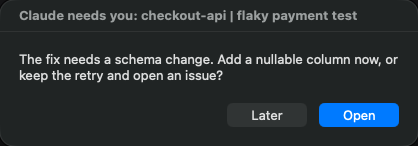

<p align="center">
  <a href="https://nobrainer.tech">
    
  </a>
</p>

<h1 align="center">Needs You</h1>

<p align="center">
  <strong>A popup when a Claude Code session needs you.<br>
  An autopilot for the hours when you are asleep.</strong>
</p>

<p align="center">
  <a href="#install">Install</a> ·
  <a href="#what-autopilot-answers">What autopilot answers</a> ·
  <a href="https://github.com/nobrainer-tech/nobrainer-tech-flow">Get NoBrainer Tech Flow</a>
</p>

<p align="center">
  <a href="https://github.com/nobrainer-tech/needs-you/actions/workflows/test.yml"></a>
  <a href="LICENSE"></a>
</p>

**Needs You** is a small Claude Code plugin for people who run several sessions
at once. A session that asks a question waits until you notice it. With five
sessions open, one of them is usually waiting.

The plugin is one hook with two jobs:

- **Needs You.** When a session waits for you (a question, a plan to approve, a
  permission prompt), you get a macOS notification with the session's name and
  the question. In the Claude desktop app, one click opens that exact session.
- **Autopilot.** Say "autopilot until 8" before you leave. Until then, a session
  that would ask you a question takes its own recommended answer and keeps
  working. Every decision is logged, and you read the list in the morning.

<p align="center">
  
</p>

## Install

You need macOS, Claude Code and `jq` (recent macOS versions include it;
otherwise `brew install jq`).

In Claude Code:

```text
/plugin marketplace add nobrainer-tech/needs-you
/plugin install needs-you@needs-you
```

Sessions that were already open pick the plugin up after a restart. To check the
setup, ask any session: `test the needs-you popup`.

For a banner with sound instead of a dialog, install `terminal-notifier`
(`brew install terminal-notifier`) and allow its notifications in
System Settings → Notifications. Without it, the plugin shows the dialog above.
If it is installed and nothing shows at all, that permission is the first thing
to check.

## Use it

By day there is nothing to do: the popup comes when a session waits.

Before you leave, tell any session:

```text
autopilot until 8
```

It answers `Autopilot ON until 2026-11-10 08:00` and covers every session on the
machine at once, with no restart. It switches itself off at that time. In the
morning ask `what did autopilot decide?`. An example report:

```text
2026-11-09 23:41  checkout-api | flaky payment test  Add a nullable column or keep the retry? -> Keep the retry (Recommended)
2026-11-10 02:17  docs-site | search page  Regenerate the search index too? -> Yes, regenerate
2026-11-10 03:05  checkout-api | flaky payment test  Merge the pull request? -> left for the owner (merge)
```

The command behind it is [`bin/nb-autopilot`](bin/nb-autopilot): `on [HH:MM]`,
`off`, `status`, `report` and `doctor`. Sessions have it on their PATH. From
your own terminal, call it by its full path.

## What autopilot answers

| A session | With autopilot on |
|---|---|
| asks a question with options (`AskUserQuestion`) | is told to take the option whose label ends with `(Recommended)`, or the first one, and continue |
| ends a turn with a question (Claude desktop app) | is told to act on its first suggested answer and finish the turn |
| ends a turn asking for a go-ahead to commit, open or merge a pull request | is told not to take that step; the question is left for you |
| has a plan waiting for approval | waits for you; you get the popup |
| needs a permission, or had a command blocked | waits for you; you get the popup |

The instruction also names what a session must never decide alone: logins and
passwords, payments, merging, pushing or deploying, publishing or sending
anything to other people, deleting data, irreversible production changes and
granting permissions. The session
skips that step, finishes the rest and leaves the question in its final message.

Three things to know before you trust it with a night:

- Autopilot tells the model what to do. It does not click for you and it grants
  no permission, so a session can still stop on something only you can do.
- The report shows the answer each session was told to take. What the session
  did next is in that session.
- It picks what the session itself recommended. It does not judge whether the
  recommendation is right.

## How it works

One Bash script, [`hooks/needs-you.sh`](hooks/needs-you.sh), is wired to four
hook events in [`hooks/hooks.json`](hooks/hooks.json): `PreToolUse`
(`AskUserQuestion`, `ExitPlanMode` and the desktop app's end-of-turn question),
`Notification`, `PermissionRequest` and `PermissionDenied`.

- The popup is a `terminal-notifier` banner, or an AppleScript dialog when no
  banner can be shown. The same message from one session shows once per two
  minutes, and a newer question replaces the dialog on screen.
- Autopilot is a `PreToolUse` "deny" whose reason is the instruction above.
- State is the end time and the decision log in `~/.claude/needs-you/`, plus
  short-lived marks in `~/Library/Caches/needs-you/`. The log only grows: delete
  it when you no longer need it. The script makes no network calls.

Two skills come with the plugin: [`autopilot`](skills/autopilot/SKILL.md) tells
a session how to switch it and how to act when its question is refused;
[`needs-you`](skills/needs-you/SKILL.md) covers setup, testing and
troubleshooting.

## Limits

- macOS only.
- The click-to-open link works for sessions of the Claude desktop app. A
  session in a terminal gets a popup with its folder name and no link.
- It runs while your Mac is awake and Claude Code is open.
- Any session that can run shell commands can switch autopilot on. The skill
  tells sessions to do it only when you ask, and autopilot never runs for more
  than 24 hours.
- Built and tested with Claude Code 2.1.321.

## Work that finishes: NoBrainer Tech Flow

Needs You decides who answers a question. It does not decide whether the work
is right. For that, use **[NoBrainer Tech Flow](https://github.com/nobrainer-tech/nobrainer-tech-flow)**,
a free, open-source workflow for AI coding agents:

- It sets the outcome and the evidence before the work starts.
- Its autopilot carries an approved plan through to the whole goal.
- At the end the agent hands over what was delivered, what was checked and what
  was not.

Together they cover a night run: Flow keeps the work on the plan, and Needs You
keeps it from stopping on a question you would have answered with "yes, the
recommended one".

## Install without the plugin system

Clone the repository and add the hook to `~/.claude/settings.json` with the
absolute path of your clone:

```json
{
  "hooks": {
    "PreToolUse": [
      { "matcher": "AskUserQuestion|ExitPlanMode|mcp__ccd_turn__wrap_up",
        "hooks": [{ "type": "command", "command": "/path/to/needs-you/hooks/needs-you.sh", "timeout": 5 }] }
    ],
    "Notification": [
      { "matcher": "permission_prompt|elicitation_dialog",
        "hooks": [{ "type": "command", "command": "/path/to/needs-you/hooks/needs-you.sh", "timeout": 5 }] }
    ],
    "PermissionRequest": [
      { "hooks": [{ "type": "command", "command": "/path/to/needs-you/hooks/needs-you.sh", "timeout": 5 }] }
    ],
    "PermissionDenied": [
      { "hooks": [{ "type": "command", "command": "/path/to/needs-you/hooks/needs-you.sh", "timeout": 5 }] }
    ]
  }
}
```

Merge it with the hooks you already have. Then run
`/path/to/needs-you/bin/nb-autopilot doctor`.

To change the popup text, set `NEEDS_YOU_TITLE`, `NEEDS_YOU_OPEN` and
`NEEDS_YOU_LATER` in the `env` block of the same file.

## Tests

```bash
bash tests/test.sh
```

60 checks run the hook and the command against stand-ins for the notifier, the
dialog and `open`, in a temporary home folder. Nothing shows on screen.

---

Built by **[NoBrainer Tech](https://nobrainer.tech)**. From task to done.

**[Use the full NoBrainer Tech Flow workflow →](https://github.com/nobrainer-tech/nobrainer-tech-flow)**
